# Next.js 16 서버 컴포넌트 에러 처리 멘탈 모델

> 이 문서는 [ADR-0001](./adr/0001-server-component-error-handling-policy.md)에서 채택된 4대 원칙을 **도표 중심으로 재구성한 초보자용 지도**입니다.
> 대상 독자: Next.js Pages Router 경험이 있으나 App Router(RSC/Streaming SSR) 에러 처리는 처음인 개발자.

---

## 0. 전체 그림 — "에러의 일생"

서버 컴포넌트에서 발생한 에러가 **어디서 태어나, 어떻게 분류되고, 누가 잡으며, 최종적으로 누가 관찰하는지**를 한 장으로 보여줍니다. 이 흐름도가 4대 원칙의 뼈대입니다.

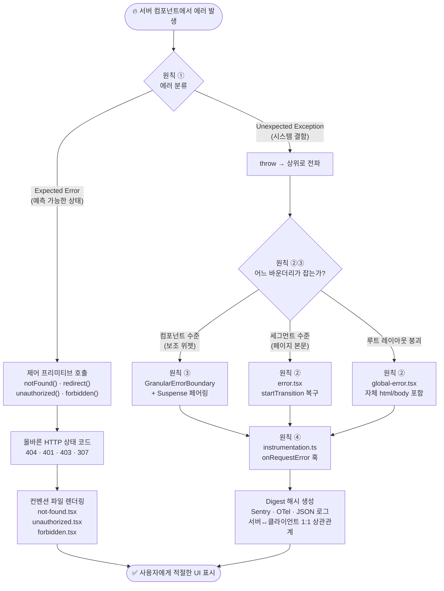

> [!TIP]
> 위 도표를 위에서 아래로 따라가면 모든 에러 시나리오가 4대 원칙 중 하나로 분기됩니다.
> 각 원칙의 상세는 아래 섹션에서 개별 도표로 확대합니다.

---

## 원칙 ① — 에러 2단계 분류 + 제어 프리미티브 우선

### 핵심 한 줄

> **"예측할 수 있는 상태는 throw하지 말고, 프레임워크가 제공하는 제어 프리미티브로 HTTP 응답을 즉시 확정하라."**

### 분류 의사결정 트리

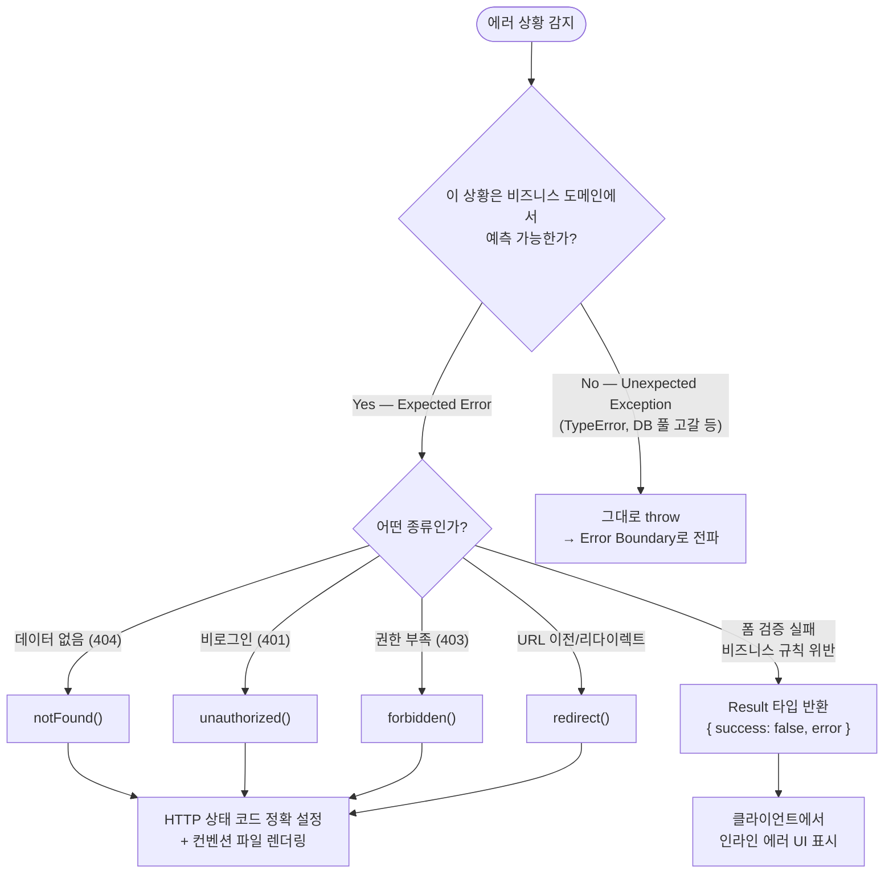

### `try/catch` 안티패턴과 해결책

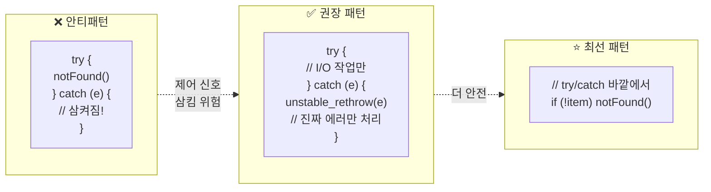

> [!IMPORTANT]
> `notFound()`, `redirect()` 등은 내부적으로 `throw`하는 **제어 흐름 신호**입니다.
> 일반 `try/catch`로 감싸면 라우팅이 중단됩니다. 불가피하게 감싸야 한다면 `catch` 선두에 `unstable_rethrow(e)`를 배치하세요.

---

## 원칙 ② — 바운더리 계층 구조 + `startTransition` 복구

### 핵심 한 줄

> **"에러 바운더리는 자기보다 바깥(부모)의 에러를 잡지 못한다. 계층을 정확히 알아야 어디서 터지고 누가 잡는지 예측할 수 있다."**

### 세그먼트 내부의 컴포넌트 중첩 구조

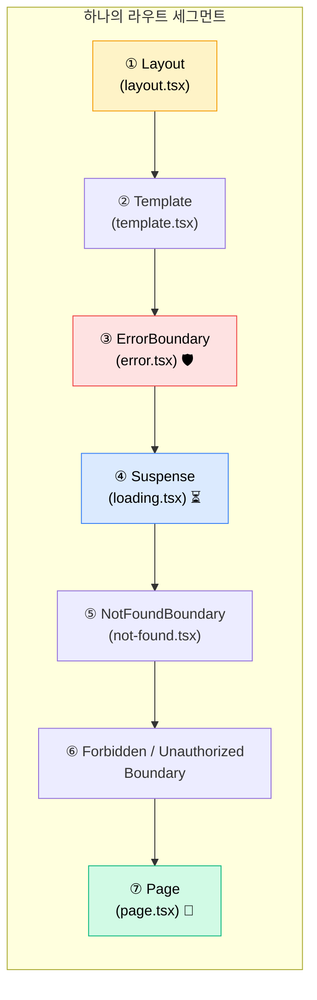

> [!NOTE]
> `Layout`은 `ErrorBoundary`보다 **바깥**에 있습니다.
> 따라서 **같은 폴더의 `error.tsx`는 같은 폴더의 `layout.tsx` 에러를 잡지 못합니다** — 부모 세그먼트의 `error.tsx`로 버블링됩니다.

### 에러 버블링 경로

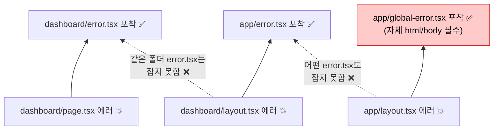

### `reset()` 단독 호출의 함정과 올바른 복구

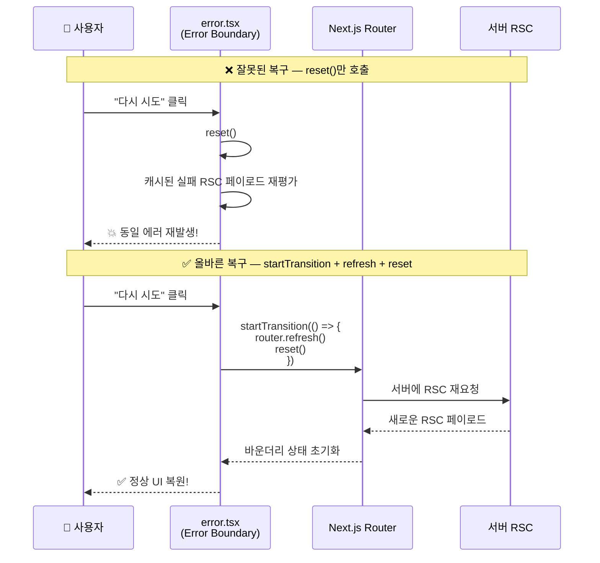

---

## 원칙 ③ — 세분화된 장애 격리 (Blast Radius 통제)

### 핵심 한 줄

> **"보조 위젯 하나가 죽었다고 페이지 전체가 죽어서는 안 된다. `GranularErrorBoundary + Suspense` 페어링으로 폭발 반경을 최소화하라."**

### Before vs After — Blast Radius 비교

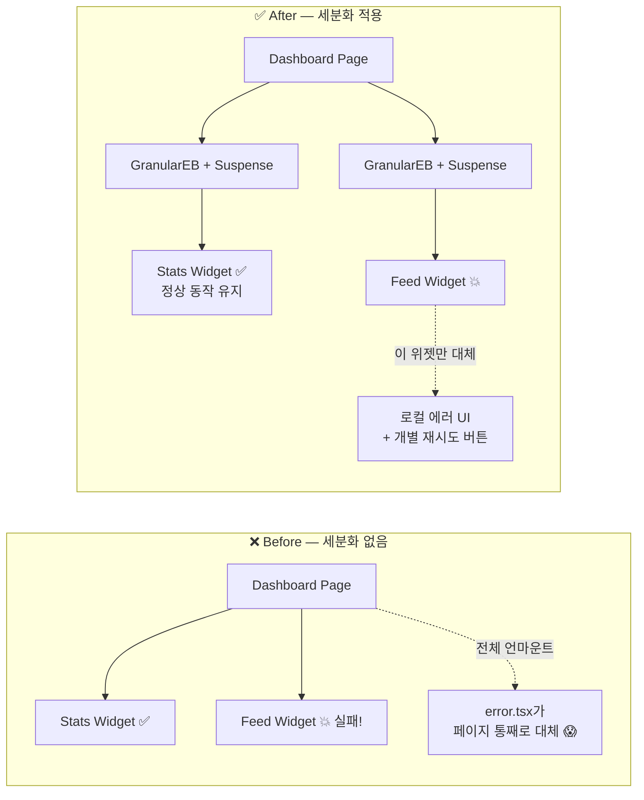

### 배치 규칙: ErrorBoundary가 Suspense를 감싼다

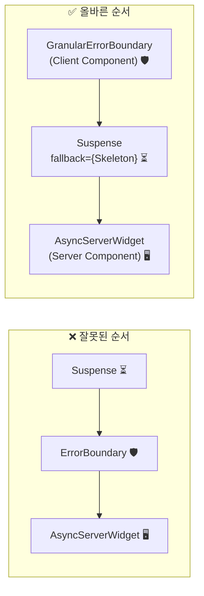

> [!WARNING]
> **ErrorBoundary가 반드시 Suspense 바깥**에 있어야 합니다.
> 순서가 뒤바뀌면 스트리밍 도중 발생한 에러가 바운더리를 우회하여 상위 세그먼트 `error.tsx`로 버블링됩니다.

---

## 원칙 ④ — `instrumentation.ts` 기반 Digest 연계 관측성

### 핵심 한 줄

> **"프로덕션에서는 에러 메시지가 마스킹된다. 유일한 연결 고리인 `digest` 해시를 서버와 클라이언트 양쪽에서 기록하여 1:1 역추적 환경을 구축하라."**

### 프로덕션 에러 마스킹 — 왜 Digest가 필요한가

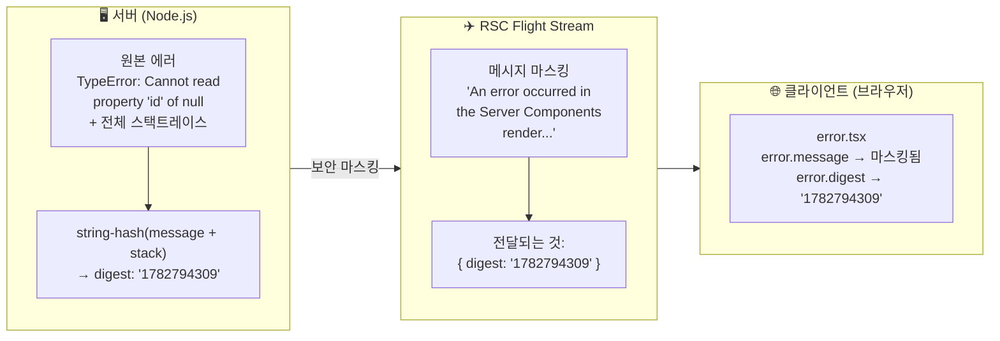

### Digest 상관관계 — 서버↔클라이언트 역추적 아키텍처

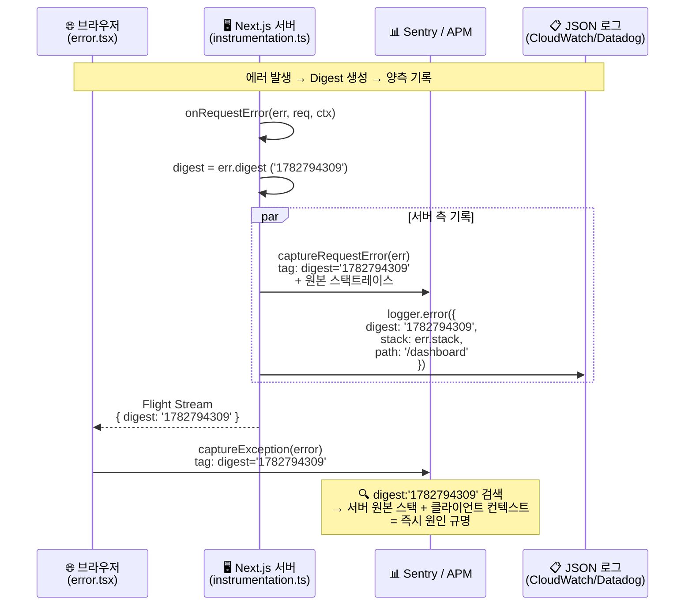

### `instrumentation.ts`가 커버하는 4가지 실행 컨텍스트

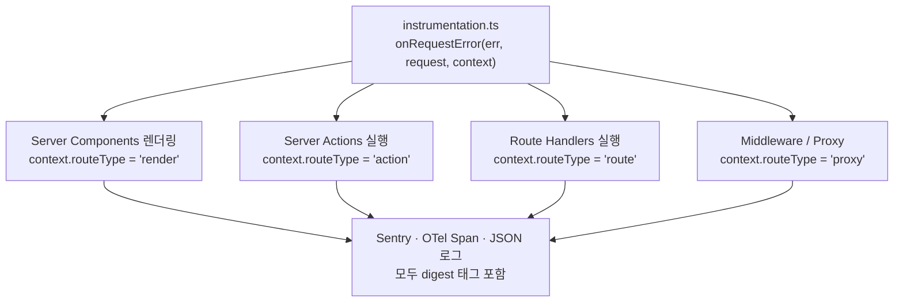

> [!CAUTION]
> `onRequestError` 내부의 네트워크 호출(Sentry 전송 등)은 **반드시 `await`** 하세요.
> 서버리스 환경(Lambda, Vercel)에서 `await` 없이 fire-and-forget 하면 인스턴스 종료 시 에러 보고가 유실됩니다.

---

## 종합 치트시트 — 시나리오별 빠른 판단표

| 시나리오 | 에러 분류 | 처리 메커니즘 | HTTP 코드 | UI |
|:---|:---|:---|:---|:---|
| 핵심 엔티티 없음 `/posts/999` | Expected | `notFound()` | **404** | `not-found.tsx` |
| 비로그인 접근 | Expected | `unauthorized()` | **401** | `unauthorized.tsx` |
| 권한 부족 | Expected | `forbidden()` | **403** | `forbidden.tsx` |
| URL 이전/리다이렉트 | Control Flow | `redirect()` | **307/303** | 브라우저 이동 |
| 폼 검증 실패 (Server Action) | Expected | Result 타입 반환 | 200 | 인라인 폼 에러 |
| 보조 위젯 API 실패 | Expected | GranularEB + Suspense | 200 | 로컬 에러 배너 |
| DB 연결 풀 고갈 | Unexpected | `throw` → Error Boundary | **500** / 200 | `error.tsx` + 재시도 |
| 루트 레이아웃 크래시 | Unexpected | `throw` → global-error | **500** | `global-error.tsx` |

---

## 더 읽기

| 문서 | 내용 |
|:---|:---|
| [ADR-0001](./adr/0001-server-component-error-handling-policy.md) | 4대 원칙의 공식 결정문 |
| [에러 분류 체계 리서치](./research/rsc-error-taxonomy.md) | Expected vs Unexpected, 제어 프리미티브, Result 패턴 심층 분석 |
| [바운더리 계층 구조 리서치](./research/error-boundary-hierarchy.md) | 세그먼트 중첩 트리, `reset()` 한계, GranularErrorBoundary 구현 |
| [Digest/관측성 리서치](./research/digest-and-observability.md) | 마스킹 알고리즘, `onRequestError`, Sentry/OTel/로깅 연계 청사진 |
| [GLOSSARY.md](../GLOSSARY.md) | 도메인 용어 사전 |
