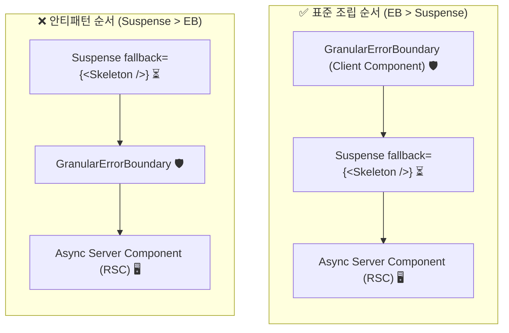

# 원칙 3 상세 설계 명세: GranularErrorBoundary 및 Blast Radius 통제 대시보드

> **상위 이슈**: [#7 [Map] Next.js 16 서버 컴포넌트 에러 처리 최소 기능 데모 앱 기획](https://github.com/ilkyeong-gn/demo-server-component-error-handling/issues/7)  
> **해당 티켓**: [#10 [원칙 3] GranularErrorBoundary 및 Blast Radius 통제 대시보드 설계](https://github.com/ilkyeong-gn/demo-server-component-error-handling/issues/10)  
> **표준 문서**: [ADR-0001](../adr/0001-server-component-error-handling-policy.md) · [멘탈 모델](../mental-model.md) · [공통 기반 명세](./demo-app-foundation.md)  
> **대화형 프로토타입**: [`prototypes/blast-radius-interaction-prototype.html`](https://github.com/ilkyeong-gn/demo-server-component-error-handling/blob/prototype/blast-radius-interaction/prototypes/blast-radius-interaction-prototype.html) (브랜치: `prototype/blast-radius-interaction`)

---

## 1. 개요 및 설계 목적

본 문서는 **원칙 3 (세분화된 장애 격리 및 Blast Radius 통제)**을 검증하고 시연하기 위한 `/demo/blast-radius` 대시보드 라우트의 컴포넌트 아키텍처, 재사용 가능한 `<GranularErrorBoundary>` 인터페이스, 그리고 로컬 Fallback UI의 상세 명세를 정의합니다.

### 핵심 전달 가치

1. **폭발 반경(Blast Radius) 통제**:
   - 대시보드와 같은 복합 페이지에서 보조적인 외부 연동 위젯(`FeedWidget`)의 장애가 전체 페이지를 마비시키지 않고, 오직 해당 위젯의 위치에만 로컬 에러 화면으로 격리됨을 입증합니다.
   - 핵심 비즈니스 위젯(`MetricsWidget`, `ProfileWidget`)은 정상 마운트 및 인터랙션을 온전히 유지합니다. (Blast Radius: 100% 붕괴 ➔ 25% 국소 격리)
2. **배치 규칙: `ErrorBoundary > Suspense` 순서 준수**:
   - Next.js 16 및 React 19의 스트리밍 RSC 환경에서 `ErrorBoundary`는 **반드시 `Suspense`의 바깥(Outer)**에 위치해야 합니다. 순서가 뒤바뀔 경우 비동기 스트리밍 도중 발생한 에러가 바운더리를 우회하여 상위 세그먼트 `error.tsx`로 누출되는 현상을 시각화하고 방지합니다.
3. **위젯 단위 독립적 복구 라이프사이클**:
   - 장애가 발생한 위젯의 로컬 Fallback UI에서 `[다시 시도 (Retry)]` 버튼을 클릭했을 때, 페이지 전체를 리로드하거나 타 위젯의 클라이언트 상태를 파괴하지 않고, `startTransition(() => { router.refresh(); reset(); })`을 통해 해당 비동기 RSC의 데이터 스트림만 안전하게 재요청합니다.

---

## 2. 화면 구조 및 UI 정보 구조 (IA)

`/demo/blast-radius` 대시보드는 2x2 반응형 위젯 그리드로 구성되며, 상단에 카오스 제어 툴바와 아키텍처 비교 토글을 제공합니다.

```text
+---------------------------------------------------------------------------------------------------+
|  Root Shell (app/layout.tsx) - GNB: Logo | Breadcrumbs | System Health: OK                        |
+---------------------------------------------------------------------------------------------------+
|  Dashboard Shell (app/demo/blast-radius/page.tsx)                                                 |
|  [헤더 & 툴바]                                                                                    |
|  - 타이틀: 통합 시스템 대시보드                                                                   |
|  - 격리 모드 토글: [✅ Granular Mode ON] vs [❌ Granular Mode OFF (위험)]                         |
|  - 카오스 주입 버튼: [💥 Feed 장애 트리거 (?chaos=unexpected&scope=feed)]                        |
|                                                                                                   |
|  +-----------------------------------------------+-----------------------------------------------+
|  | [위젯 1: ProfileWidget] (Async RSC)           | [위젯 2: MetricsWidget] (Async RSC)           |
|  | - 사용자 아바타, 권한 티어                     | - 일일 활성 사용자, 응답 지연시간             |
|  | - 상태: ✅ 항상 정상 렌더링                   | - 상태: ✅ 항상 정상 렌더링                   |
|  +-----------------------------------------------+-----------------------------------------------+
|  | [위젯 3: FeedWidget] (Async RSC)              | [위젯 4: RecommendationsWidget] (Async RSC)   |
|  | - 외부 서드파티 배포/웹훅 이벤트 스트림        | - 권장 최적화 가이드 카드                     |
|  | - 카오스 주입 대상 위젯                       | - 상태: ✅ 항상 정상 렌더링                   |
|  |                                               |                                               |
|  | [장애 발생 시: Granular Mode ON]               |                                               |
|  | ➔ 로컬 위젯 Fallback 카드 표시                |                                               |
|  |   - ⚠️ 외부 피드를 불러올 수 없습니다          |                                               |
|  |   - Digest 해시 배지 표시                     |                                               |
|  |   - [🔄 이 위젯만 다시 시도] 버튼             |                                               |
|  +-----------------------------------------------+-----------------------------------------------+
+---------------------------------------------------------------------------------------------------+
```

### 상태별 화면 전이 및 폭발 반경 매트릭스

| 격리 설정 | 장애 발생 지점 | 활성화 바운더리 | 영향 범위 (Blast Radius) | 사용자 경험 영향 |
|:---|:---|:---|:---|:---|
| **Granular ON (표준)** | `FeedWidget` 단독 장애 | `<GranularErrorBoundary name="FeedWidget">` | **25% (해당 위젯 국소 격리)** | 프로필, 통계 지표, 네비게이션 모두 정상 이용 가능. 피드만 Fallback 안내 및 개별 재시도 제공. |
| **Granular OFF (안티패턴)** | `FeedWidget` 단독 장애 | `app/demo/blast-radius/error.tsx` (Segment Shell) | **100% (대시보드 전체 붕괴)** | Feed 위젯 하나의 오류로 인해 대시보드 전체가 언마운트되고 전체 에러 화면 노출. |
| **순서 역전 (`Suspense > EB`)** | `FeedWidget` 스트리밍 중 에러 | `app/demo/blast-radius/error.tsx` (상위 누출) | **100% (대시보드 전체 붕괴)** | 에러 바운더리가 서스펜스 내부에 갇혀 스트리밍 에러를 캐치하지 못하고 상위로 버블링됨. |

---

## 3. `<GranularErrorBoundary>` 재사용 컴포넌트 인터페이스

Client Component (`'use client'`)로 작성되는 `<GranularErrorBoundary>`는 React의 클래스형 에러 바운더리 프리미티브와 Next.js 16의 `useRouter`, `useTransition` 훅을 통합하여 제공합니다.

### 3.1 TypeScript 인터페이스 명세

```typescript
// app/demo/blast-radius/components/GranularErrorBoundary.tsx
'use client';

import React, { Component, ReactNode, TransitionStartFunction } from 'react';

export interface GranularFallbackProps {
  error: Error & { digest?: string };
  reset: () => void;
  name?: string;
}

export interface GranularErrorBoundaryProps {
  children: ReactNode;
  name?: string; // 관측성 및 로깅용 식별자
  fallback?: ReactNode | ((props: GranularFallbackProps) => ReactNode);
  onReset?: () => void;
  onError?: (error: Error, info: React.ErrorInfo) => void;
}
```

### 3.2 핵심 내부 구현 및 복구 로직

단순 클래스 컴포넌트만으로는 Next.js 16 App Router의 `router.refresh()` 및 `startTransition` 훅을 직접 호출할 수 없으므로, 내부 `InnerErrorBoundary` 클래스와 외부 래퍼 함수형 컴포넌트의 2단계 구조로 캡슐화합니다.

```tsx
'use client';

import React, { Component, ReactNode, useTransition } from 'react';
import { useRouter } from 'next/navigation';

interface State {
  hasError: boolean;
  error: (Error & { digest?: string }) | null;
}

class InnerErrorBoundary extends Component<
  GranularErrorBoundaryProps & { onInternalReset: () => void },
  State
> {
  constructor(props: GranularErrorBoundaryProps & { onInternalReset: () => void }) {
    super(props);
    this.state = { hasError: false, error: null };
  }

  static getDerivedStateFromError(error: Error): State {
    return { hasError: true, error };
  }

  componentDidCatch(error: Error, errorInfo: React.ErrorInfo) {
    if (this.props.onError) {
      this.props.onError(error, errorInfo);
    }
    // 콘솔 및 로컬 모의 관측성 태깅
    console.error(`[GranularErrorBoundary:${this.props.name || 'Anonymous'}]`, error);
  }

  reset = () => {
    this.props.onInternalReset();
    this.setState({ hasError: false, error: null });
  };

  render() {
    if (this.state.hasError && this.state.error) {
      if (typeof this.props.fallback === 'function') {
        return this.props.fallback({
          error: this.state.error,
          reset: this.reset,
          name: this.props.name,
        });
      }
      if (this.props.fallback) {
        return this.props.fallback;
      }
      // 기본 내장 Fallback UI
      return (
        <DefaultWidgetFallback
          error={this.state.error}
          reset={this.reset}
          name={this.props.name}
        />
      );
    }

    return this.props.children;
  }
}

export function GranularErrorBoundary(props: GranularErrorBoundaryProps) {
  const router = useRouter();
  const [isPending, startTransition] = useTransition();

  const handleInternalReset = () => {
    props.onReset?.();
    startTransition(() => {
      router.refresh(); // 최신 서버 컴포넌트 페이로드 재요청
    });
  };

  return <InnerErrorBoundary {...props} onInternalReset={handleInternalReset} />;
}
```

---

## 4. 컴포넌트 조립 규칙: `ErrorBoundary > Suspense` 순서의 법칙

Next.js 16 및 React 19 환경에서 서버 컴포넌트(Async RSC)를 감쌀 때 조립 순서는 절대로 임의로 결정할 수 없습니다.



### 왜 ErrorBoundary가 Suspense 바깥이어야 하는가?

1. **스트리밍 라이프사이클의 에러 전파 경로**:
   - 서버 컴포넌트가 렌더링 중 Promise를 던지면(Throw Promise) 가장 가까운 상위 `<Suspense>`가 이를 포착해 로딩 스켈레톤을 렌더링합니다.
   - 스트리밍 중 비동기 페칭이 실패하여 Promise가 reject되면, React 19 런타임은 에러를 Suspense 경계 바깥으로 방출합니다.
   - 만약 ErrorBoundary가 Suspense 안쪽에 있다면, 이미 Suspense 밖으로 방출된 에러를 감지할 수 없어 세그먼트 레벨 `error.tsx`까지 에러가 누출됩니다.
2. **복구 시 스켈레톤 재노출 보장**:
   - ErrorBoundary가 Suspense 바깥에 위치해야, 복구 재시도 시 에러 바운더리가 초기화되면서 Suspense의 스켈레톤이 다시 활성화되어 자연스러운 비동기 로딩 경험을 사용자에게 제공할 수 있습니다.

---

## 5. 대시보드 위젯 명세 (`app/demo/blast-radius/components/`)

### 5.1 `MetricsWidget.tsx` (정상 비즈니스 지표 RSC)
- **책임**: 시스템 핵심 KPI(일일 활성 사용자 수, P99 지연시간 등)를 서버에서 페칭하여 렌더링.
- **특징**: 항상 성공적으로 응답하여 다른 위젯 장애 시에도 정상 동작함을 증명.

### 5.2 `ProfileWidget.tsx` (사용자 인증 프로필 RSC)
- **책임**: 현재 로그인된 관리자 프로필 정보(Alex Dev, Tier-1) 렌더링.
- **특징**: 세션 정보 기반 렌더링으로, 장애 위젯 발생 시에도 계정 영역이 깨지지 않음을 증명.

### 5.3 `FeedWidget.tsx` (장애 시뮬레이션 대상 외부 피드 Async RSC)
- **책임**: 서드파티 RSS 또는 실시간 시스템 알림 스트림 렌더링.
- **카오스 제어 연동**:
  ```typescript
  import { evaluateChaos } from '@/lib/chaos';

  export async function FeedWidget({ searchParams }: { searchParams: Promise<Record<string, string>> }) {
    const params = await searchParams;
    
    // 카오스 주입 평가: scope가 feed이고 chaos=unexpected인 경우 인위적 크래시 발생
    evaluateChaos(params, 'feed');

    const feedItems = await fetchExternalFeed();
    return <FeedList items={feedItems} />;
  }
  ```

---

## 6. 로컬 Fallback UI 상세 명세 (`DefaultWidgetFallback`)

`<GranularErrorBoundary>`에 커스텀 `fallback`을 제공하지 않을 때 기본으로 렌더링되는 로컬 Fallback 컴포넌트입니다.

```tsx
// app/demo/blast-radius/components/DefaultWidgetFallback.tsx
'use client';

import React, { useTransition } from 'react';

export function DefaultWidgetFallback({
  error,
  reset,
  name,
}: {
  error: Error & { digest?: string };
  reset: () => void;
  name?: string;
}) {
  const [isRetrying, startTransition] = useTransition();

  const handleRetry = () => {
    startTransition(() => {
      reset();
    });
  };

  return (
    <div className="flex flex-col items-center justify-center p-6 border border-dashed border-red-500/40 bg-red-500/5 rounded-lg text-center h-full min-h-[220px]">
      <div className="text-2xl mb-2">⚠️</div>
      <h3 className="text-sm font-semibold text-red-300 mb-1">
        {name ? `${name} 위젯을 불러올 수 없습니다` : '위젯 렌더링 실패'}
      </h3>
      <p className="text-xs text-slate-300 max-w-xs mb-3">
        외부 업스트림 서비스 장애가 감지되었습니다. 대시보드의 다른 지표는 정상 동작합니다.
      </p>

      {error.digest && (
        <div className="font-mono text-[10px] bg-black/40 border border-red-500/30 text-red-400 px-2 py-0.5 rounded mb-3">
          Digest: {error.digest}
        </div>
      )}

      <button
        onClick={handleRetry}
        disabled={isRetrying}
        className="px-3 py-1.5 bg-sky-500 hover:bg-sky-400 text-slate-950 font-bold text-xs rounded transition flex items-center gap-1.5 disabled:opacity-50"
      >
        <span>{isRetrying ? '⏳ 복구 시도 중...' : '🔄 이 위젯만 다시 시도'}</span>
      </button>
    </div>
  );
}
```

---

## 7. 시연 시나리오 및 핸즈온 가이드

| 시나리오 | 실행 절차 및 쿼리 파라미터 | 관찰 대상 및 판정 기준 |
|:---|:---|:---|
| **시나리오 1: Granular 격리 성공** | 1. Granular Mode ON 상태에서 `?chaos=unexpected&scope=feed` 실행.<br>2. 대시보드 화면 확인. | **판정**: Profile과 Metrics 카드는 온전히 표시되고 동작함. Feed 영역만 로컬 Fallback 카드로 대체됨 (Blast Radius 25%). |
| **시나리오 2: Granular 미적용 붕괴 대비** | 1. 상단 토글을 Granular Mode OFF로 변경.<br>2. 동일한 Feed 에러 트리거. | **판정**: Profile과 Metrics가 사라지고 페이지 전체가 `demo/blast-radius/error.tsx`로 전멸 (Blast Radius 100%). |
| **시나리오 3: 올바른 순서 검증** | 1. 순서 토글을 `Suspense > EB` (잘못된 순서)로 변경.<br>2. Feed 에러 트리거. | **판정**: GranularEB가 켜져 있어도 스트리밍 에러가 상위로 누출되어 대시보드 전체가 파괴됨을 확인. |
| **시나리오 4: 위젯 단위 독립 복구** | 1. Feed 장애 상태에서 카오스 파라미터 제거.<br>2. Feed 카드의 `[이 위젯만 다시 시도]` 클릭. | **판정**: 전체 페이지 리로드 없이 Feed 위젯만 로딩 후 정상 복원됨. Metrics의 카운터나 입력 상태가 리셋되지 않음. |

---

## 8. 산출물 및 추적성 링크

- **상세 설계 명세**: [docs/specs/principle-3-blast-radius.md](https://github.com/ilkyeong-gn/demo-server-component-error-handling/blob/main/docs/specs/principle-3-blast-radius.md)
- **대화형 프로토타입**: [`prototype/blast-radius-interaction` 브랜치의 prototypes/blast-radius-interaction-prototype.html](https://github.com/ilkyeong-gn/demo-server-component-error-handling/blob/prototype/blast-radius-interaction/prototypes/blast-radius-interaction-prototype.html)
- **상위 이슈**: [#7 [Map] Next.js 16 서버 컴포넌트 에러 처리 최소 기능 데모 앱 기획](https://github.com/ilkyeong-gn/demo-server-component-error-handling/issues/7)
- **해당 티켓**: [#10 [원칙 3] GranularErrorBoundary 및 Blast Radius 통제 대시보드 설계](https://github.com/ilkyeong-gn/demo-server-component-error-handling/issues/10)
